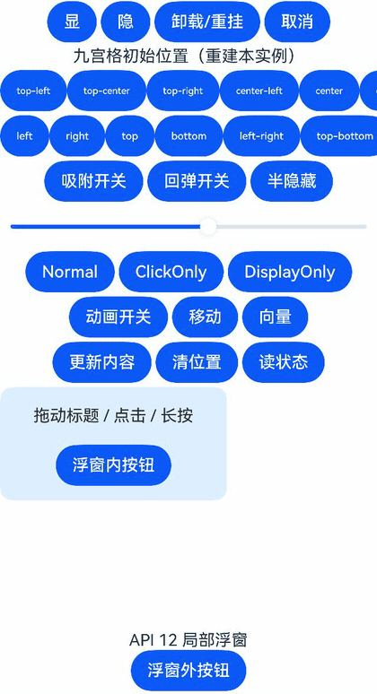
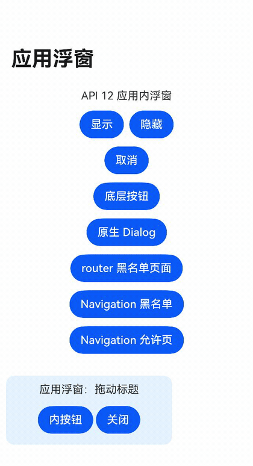

# FloatingX-Harmony

**FloatingX-Harmony** 是原生 ArkTS / ArkUI 悬浮窗库，提供局部浮窗、应用内浮窗和受平台权限约束的系统浮窗。以一个 HAR 接入，最低兼容 **HarmonyOS 5.0.0（API 12）**。

Android 版：[FloatingX](https://github.com/Petterpx/FloatingX)（Kotlin / Java / Jetpack Compose）。两端共享浮窗使用思路，使用各自平台的 API。

[使用文档](docs/guide/Home.md) · [快速开始](docs/guide/快速开始.md) · [API 速查](docs/guide/API-速查.md)

## 特性

- **三种作用范围**：组件中的局部浮窗、单主窗口应用浮层、系统窗口。
- **ArkUI 内容**：使用带类型的 Builder 参数，支持更新内容。
- **定位与移动**：九宫格初始定位、vp 坐标、边距、绝对与向量移动。
- **拖动与交互**：指定拖动区域，支持点击、长按与拖动回调。
- **边缘行为**：六种吸附方向、回弹与可配置半隐藏比例。
- **显示模式与动画**：普通、仅点击、仅展示；显隐与移动动画。
- **页面与位置管理**：应用内页面黑白名单，可选内存或 Preferences 位置保存。
- **多实例**：按 tag 查找和卸载应用内 / 系统浮窗；Promise 控制与事件通知。

## 效果演示

以下 GIF 来自 **API 24 模拟器**中的实际示例应用操作。

| 局部浮窗 | 应用内浮窗 |
| --- | --- |
|  |  |

系统浮窗需要目标平台授予受限权限；模拟器表现不能代表商业手机 / 平板可取得该权限。接入前请阅读[系统浮窗](docs/guide/系统浮窗.md)。

## 安装

当前**尚未发布到 OHPM 仓库**，使用本地 HAR：

1. 用 DevEco Studio 打开仓库并同步依赖，在 `floatingx` 模块执行 `assembleHar`。
2. 将产出的 `floatingx.har` 放进应用模块的 `libs/` 目录。
3. 在该模块的 `oh-package.json5` 添加依赖并重新同步：

```json5
{
  "dependencies": {
    "floatingx": "file:./libs/floatingx.har"
  }
}
```

库的公开入口是 `floatingx`。局部 / 应用内浮窗不需要声明系统浮窗权限；仅系统浮窗消费者按平台要求声明权限。详细步骤见[快速开始](docs/guide/快速开始.md)。

## 快速开始

局部浮窗适合页面内悬浮按钮、工具面板等场景。以下是可放入 Stage 工程 `pages/Index.ets` 的完整页面；页面结束时取消浮窗。

```ts
import { FloatingX, FloatingXHost, FxContent, FxControl, FxConfig } from 'floatingx';

class FloatParams {
  label: string;
  constructor(label: string) { this.label = label; }
}

@Builder
function floatContent(params: FloatParams) {
  Text(params.label)
    .width(180).height(64)
    .backgroundColor('#DDEEFF').borderRadius(12)
}

@Entry
@Component
struct Index {
  @State private message: string = '';
  private active: boolean = false;
  private control: FxControl<FloatParams> = FloatingX.createScope({
    content: new FxContent(wrapBuilder(floatContent),
      new FloatParams('拖动我'), { width: 180, height: 64 }),
    config: new FxConfig({ position: { x: 20, y: 80 } })
  });

  aboutToAppear(): void {
    this.active = true;
    this.run(this.control.show());
  }

  aboutToDisappear(): void {
    this.active = false;
    this.run(this.control.cancel());
  }

  private run(action: Promise<void>): void {
    action.catch((error: Error) => {
      if (this.active) this.message = error.message;
    });
  }

  @Builder
  pageContent() {
    Column({ space: 12 }) {
      Text(this.message)
      Button('显示').onClick(() => this.run(this.control.show()))
      Button('隐藏').onClick(() => this.run(this.control.hide()))
    }.width('100%').height('100%').padding(16)
  }

  build() {
    Stack() {
      FloatingXHost({
        control: this.control,
        host: () => { this.pageContent(); }
      }).width('100%').height('100%')
    }.width('100%').height('100%')
  }
}
```

`show()` 接受显示请求；宿主挂载并完成布局后才实际显示。需要判断可见性时使用 `isShow()` 或 `SHOW` 事件。更多模式见 使用文档中的[应用内浮窗](docs/guide/应用内浮窗.md)和[系统浮窗](docs/guide/系统浮窗.md)。

## 文档与示例

- [快速开始](docs/guide/快速开始.md) — HAR 安装与完整最小示例
- [局部浮窗](docs/guide/局部浮窗.md) — 组件宿主与重挂
- [应用内浮窗](docs/guide/应用内浮窗.md) — WindowStage、页面黑白名单
- [系统浮窗](docs/guide/系统浮窗.md) — 权限、显式降级与释放
- [配置与交互](docs/guide/配置与交互.md) — 定位、吸附、半隐藏、动画与手势
- [位置存储](docs/guide/位置存储.md) — 内存、Preferences 与恢复
- [API 速查](docs/guide/API-速查.md) — 控制器、事件与错误
- [常见问题](docs/guide/常见问题.md) · [Android 迁移](docs/guide/Android-迁移.md)

仓库 `entry` 模块提供完整可运行示例，可在 DevEco Studio 中运行：

| 示例 | 内容 |
| --- | --- |
| [ScopeDemo](entry/src/main/ets/pages/ScopeDemo.ets) | 定位、吸附、半隐藏、交互、更新内容与宿主重挂 |
| [AppDemo](entry/src/main/ets/pages/AppDemo.ets) | 应用浮层、router / Navigation 黑名单与 Dialog |
| [MultipleDemo](entry/src/main/ets/pages/MultipleDemo.ets) | 多 tag、白名单、Preferences 与卸载 |
| [SystemDemo](entry/src/main/ets/pages/SystemDemo.ets) | 系统窗口、显式应用内降级与关闭 |

## 许可

采用 [MIT License](LICENSE)。本仓库为 Android [FloatingX](https://github.com/Petterpx/FloatingX) 的独立 HarmonyOS 实现。
